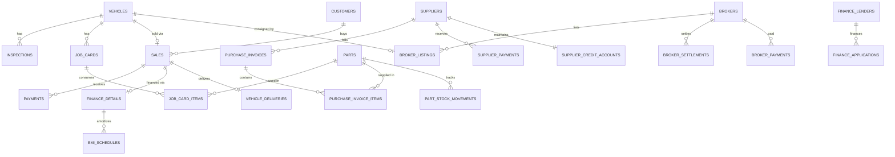

# DEALEROS — Database Schema & Entity Relationships (Document 06)

## 1. Schema Migration History
The database schema is managed via sequential Flyway SQL migrations located in [`src/main/resources/db/migration`](file:///d:/dealershipManagementSystem/src/main/resources/db/migration):
- **`V1__init_schema.sql`**: Initial schema definition (Users, Roles, Permissions, Vehicles, Inspections, Job Cards, Customers, Sales, Payments, Deliveries, Brokers, Settlements, Services).
- **`V2__seed_default_data.sql`**: Baseline seeding for administrative roles, default users, permissions, inspection checkpoints, and sample data.
- **`V3__enhance_inventory_and_purchasing.sql`**: Comprehensive inventory enhancement creating `suppliers`, `supplier_credit_accounts`, `parts`, `purchase_invoices`, `purchase_invoice_items`, `supplier_payments`, and `part_stock_movements`.
- **`V4__automotive_finance_and_loans.sql`**: Automotive finance module creating `finance_lenders`, `finance_applications`, and altering `finance_details`, `emi_schedules`, and `sales`.

---

## 2. Core Entity Relationship Diagram (ERD)

---

## 3. Key Table Specifications

### 3.1 `vehicles`
- **PK**: `id` BIGINT AUTO_INCREMENT
- **Fields**:
  - `registration_number` VARCHAR(30) UNIQUE NOT NULL
  - `brand` VARCHAR(60) NOT NULL
  - `model` VARCHAR(60) NOT NULL
  - `variant` VARCHAR(60)
  - `manufacturing_year` INT NOT NULL
  - `ownership_type` ENUM('OWN', 'BROKER') NOT NULL
  - `category` ENUM('CAR', 'TWO_WHEELER', 'COMMERCIAL') NOT NULL
  - `status` ENUM('PROCURED', 'IN_INSPECTION', 'IN_REPAIR', 'READY_FOR_SALE', 'BOOKED', 'SOLD', 'DELIVERED') NOT NULL
  - `purchase_price` DECIMAL(12, 2) NOT NULL
  - `selling_price` DECIMAL(12, 2) NOT NULL
  - `broker_asking_price` DECIMAL(12, 2)
  - `km_driven` INT
  - `fuel_type` VARCHAR(30)
  - `transmission` VARCHAR(30)

### 3.2 `parts`
- **PK**: `id` BIGINT AUTO_INCREMENT
- **Fields**:
  - `part_number` VARCHAR(100) UNIQUE NOT NULL
  - `name` VARCHAR(150) NOT NULL
  - `category` VARCHAR(60) NOT NULL
  - `unit_of_measure` VARCHAR(20) DEFAULT 'PCS'
  - `current_stock` INT NOT NULL DEFAULT 0
  - `min_stock_level` INT NOT NULL DEFAULT 5
  - `cost_price` DECIMAL(10, 2) NOT NULL
  - `selling_price` DECIMAL(10, 2) NOT NULL
  - `compatible_models` TEXT

### 3.3 `purchase_invoices` & `purchase_invoice_items`
- **PK**: `id` BIGINT AUTO_INCREMENT
- **Fields (`purchase_invoices`)**:
  - `invoice_number` VARCHAR(100) UNIQUE NOT NULL
  - `supplier_id` BIGINT FK → `suppliers(id)`
  - `invoice_date` DATE NOT NULL
  - `due_date` DATE
  - `subtotal` DECIMAL(12, 2) NOT NULL
  - `tax_amount` DECIMAL(12, 2) NOT NULL DEFAULT 0
  - `total_amount` DECIMAL(12, 2) NOT NULL
  - `paid_amount` DECIMAL(12, 2) NOT NULL DEFAULT 0
  - `balance_amount` DECIMAL(12, 2) NOT NULL
  - `payment_status` ENUM('UNPAID', 'PARTIALLY_PAID', 'PAID') NOT NULL
  - `stock_receipt_status` ENUM('PENDING', 'RECEIVED', 'CANCELLED') NOT NULL

### 3.4 `sales` & `payments`
- **PK**: `id` BIGINT AUTO_INCREMENT
- **Fields (`sales`)**:
  - `sale_number` VARCHAR(50) UNIQUE NOT NULL
  - `vehicle_id` BIGINT FK → `vehicles(id)` UNIQUE
  - `customer_id` BIGINT FK → `customers(id)`
  - `sale_date` DATE NOT NULL
  - `agreed_price` DECIMAL(12, 2) NOT NULL
  - `discount_amount` DECIMAL(12, 2) DEFAULT 0
  - `final_sale_price` DECIMAL(12, 2) NOT NULL
  - `paid_amount` DECIMAL(12, 2) DEFAULT 0
  - `balance_amount` DECIMAL(12, 2) NOT NULL
  - `sale_type` ENUM('DIRECT', 'FINANCE') NOT NULL
  - `status` ENUM('CONFIRMED', 'COMPLETED', 'CANCELLED') NOT NULL

### 3.5 `finance_details` & `emi_schedules`
- **PK**: `id` BIGINT AUTO_INCREMENT
- **Fields (`finance_details`)**:
  - `sale_id` BIGINT FK → `sales(id)`
  - `finance_company` VARCHAR(100) NOT NULL
  - `finance_type` ENUM('IN_HOUSE', 'EXTERNAL_BANK') DEFAULT 'IN_HOUSE'
  - `lender_id` BIGINT FK → `finance_lenders(id)`
  - `loan_account_number` VARCHAR(100)
  - `loan_amount` DECIMAL(12, 2) NOT NULL
  - `down_payment` DECIMAL(12, 2) NOT NULL
  - `principal_outstanding` DECIMAL(12, 2)
  - `interest_rate` DECIMAL(5, 2) NOT NULL
  - `tenure_months` INT NOT NULL
  - `emi_amount` DECIMAL(10, 2) NOT NULL
  - `emi_due_day` INT NOT NULL DEFAULT 5
  - `loan_start_date` DATE NOT NULL
  - `loan_end_date` DATE NOT NULL
  - `status` ENUM('ACTIVE', 'CLOSED', 'DEFAULTED', 'SETTLED') NOT NULL
