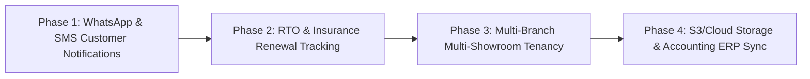

# DEALEROS — Future Implementation Roadmap (Document 14)

## 1. Overview
Having thoroughly stabilized and verified the core DEALEROS ecosystem (Vehicles, Workshop, Spare Parts Inventory, Costing, Sales, Consignment Brokers, and Automotive Finance), this roadmap outlines the recommended phased enhancements for scaling the dealership operations.

---

## 2. Implementation Phases

### Phase 1: Automated Customer Communications (WhatsApp / SMS)
- **Objective**: Automate transactional notices for EMI payment receipts, upcoming installment due dates (3 days prior), service reminders, and delivery gatepasses.
- **Components**: Twilio / Gupshup / Karix webhook service integration.
- **Risk / Dependencies**: Requires SMS DLT registration and WhatsApp Business API credentials in India.

### Phase 2: RTO & Insurance Renewal Tracking
- **Objective**: Track RTO ownership transfer status, pending challans, and insurance policy expiry alerts with direct renewal quote generation.
- **Components**: `vehicle_insurance_policies` entity, Parivahan / RTO API adapter.

### Phase 3: Multi-Branch & Multi-Showroom Tenancy
- **Objective**: Expand branch segregation so enterprise dealership groups can isolate vehicle stock, workshop bays, and sales teams across separate geographic showrooms while consolidating financial reports at headquarters.
- **Components**: `branches` table, Hibernate `@Filter` for tenant isolation, branch-level user permissions.

### Phase 4: S3 Cloud Document Storage & Accounting ERP Sync
- **Objective**: Store customer PAN cards, Aadhaar, vehicle RC books, and invoices in Amazon S3 or MinIO; export ledger entries to Tally Prime or Zoho Books.
